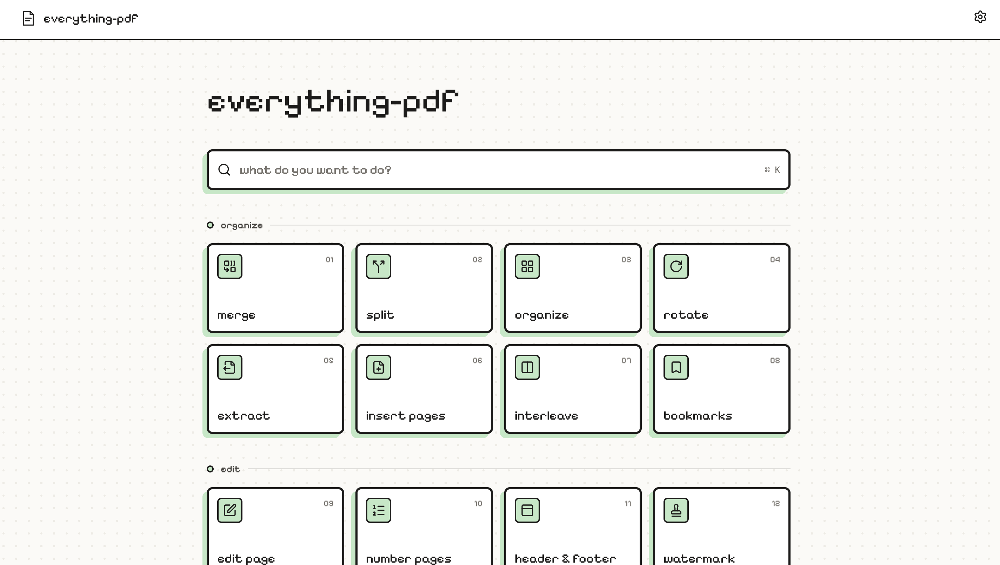
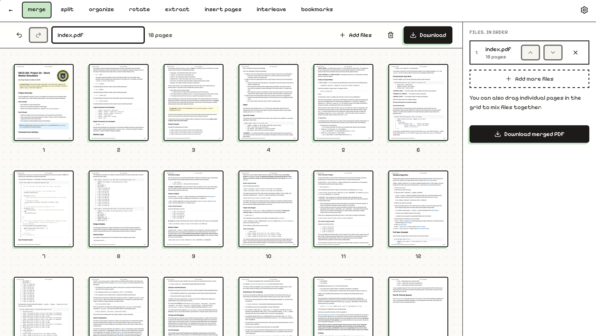

# Everything PDF

Everything PDF is a website for everything you'd want to do with a PDF. All processing happens
in the browser, so your files are never uploaded.



## Features

- **Organize:** merge, split, reorder, rotate, insert and interleave pages, and edit bookmarks
- **Edit:** add text, images, links, highlights, notes, form fields, page numbers, headers,
  footers and watermarks
- **Redact:** remove content for real, not just cover it up
- **Sign and fill:** sign (drawn or with a certificate), verify signatures and fill forms
- **Transform pages:** crop, resize, dark-mode, invert or grayscale pages
- **Print layouts:** make n-up sheets, booklets and posters
- **Security:** password-protect, unlock and strip metadata
- **Optimize:** compress, repair and OCR
- **More:** compare two versions, scan pages with a camera, and convert to and from images and
  text
- **Batch:** run any of it on many files at once, with saved recipes

After the first visit the app works offline (except OCR's first run, which downloads its
language data). Press `⌘K` / `Ctrl+K` anywhere to jump to a tool.

See [PLAN.md](PLAN.md) for the full feature list and roadmap.

## Installation

Requires Node 22.22+ (Node 24 recommended; see `.nvmrc`).

```sh
npm install
```

## Usage

### Web app

```sh
npm run dev        # http://localhost:5173
```

Pick a tool from the home page, add your files, and download the result.



### Command line

The same tools work from the terminal:

```sh
npm run build              # builds the CLI to packages/cli/dist
npx epdf                   # list commands
npx epdf merge a.pdf b.pdf -o both.pdf
npx epdf split big.pdf --every 10
npx epdf rotate scan.pdf --angle -90 --pages 2,4
npx epdf invert slides.pdf
npx epdf sign contract.pdf --image signature.png --page 3 --x 60% --y 80% --width 25%
npx epdf compress photos.pdf --level high
npx epdf redact report.pdf --find "Jane Doe" --pattern email,phone
npx epdf dark slides.pdf
npx epdf protect contract.pdf --password s3cret --no-copy
npx epdf sign-cert contract.pdf --cert me.p12 --password … --visible
```

To use `epdf` from anywhere: `npm install -g ./packages/cli` (after building).

## Contributing

Pull requests are welcome. For major changes, please open an issue first to discuss what you
would like to change.

Please make sure to update tests as appropriate.

### Scripts

| Command             | What it does                      |
| ------------------- | --------------------------------- |
| `npm run dev`       | Start the web app with hot reload |
| `npm run build`     | Build the web app and the CLI     |
| `npm run preview`   | Serve the production build        |
| `npm test`          | Run the engine and CLI tests      |
| `npm run typecheck` | Typecheck every package           |
| `npm run lint`      | Lint everything                   |
| `npm run format`    | Format everything with Prettier   |

### Project layout

```
apps/web/          React app (Vite, Tailwind, Zustand, dnd-kit)
  src/routes/      Home, the workspace (one route per tool), Images → PDF, batch, compare, scan
  src/tools/       Tool registry and each tool's side panel
  src/store/       Workspace state: pages, selection, undo/redo history
  src/lib/         pdf.js rendering, worker bridge, downloads, image helpers
  src/workers/     Web Worker that runs the engine off the main thread
  service-worker.js  Offline cache; the build fills in the file list (see vite.config.ts)
packages/engine/   Framework-free PDF operations (pdf-lib, qpdf-wasm, node-forge), tested in Node
packages/cli/      The `epdf` command-line tool, built on the engine
```

### How it fits together

- The **workspace** holds a list of pages, each pointing at a page of an uploaded file plus a
  rotation. Reordering, rotating, deleting and duplicating only edit that list, so they're
  instant. Real PDF bytes are built (`engine.assemble`) when you download or run a tool.
- Tools that change content (edit page, page numbers, watermark, sign, crop, invert, OCR…)
  build the current document, transform it in the **engine worker**, and replace the workspace
  with the result as one undoable step. Tools that produce something else (protect, PDF to
  images/text, extract images) download it and leave the workspace as it is.
- Encrypted PDFs are decrypted with qpdf as they're loaded, after asking for the password.
- `@everything-pdf/engine` exports everything. `@everything-pdf/engine/pure` exports only the
  helpers that don't need pdf-lib, so the main page bundle stays small.
